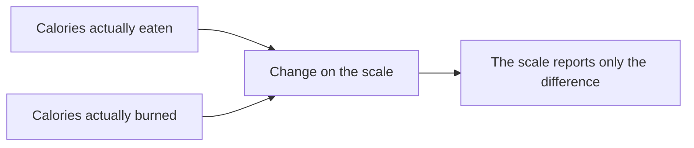
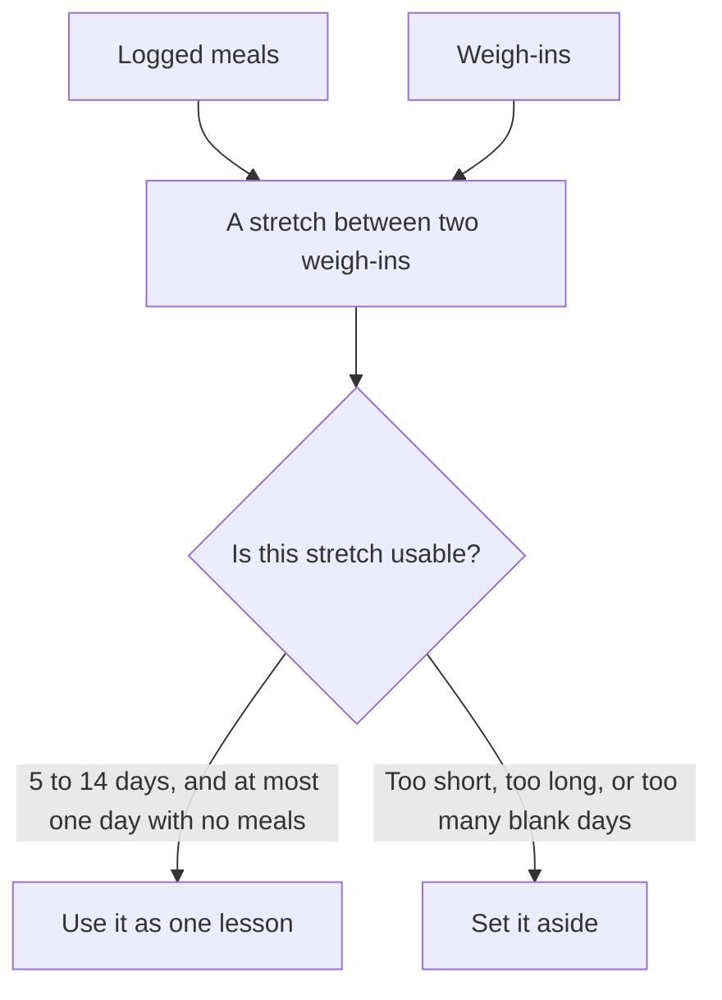
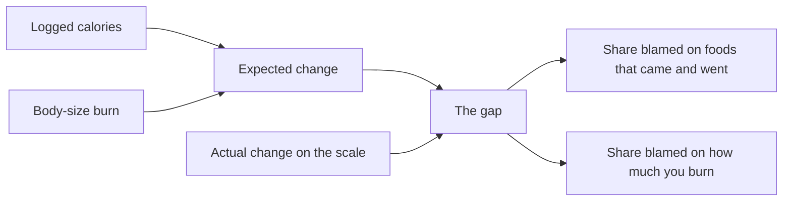
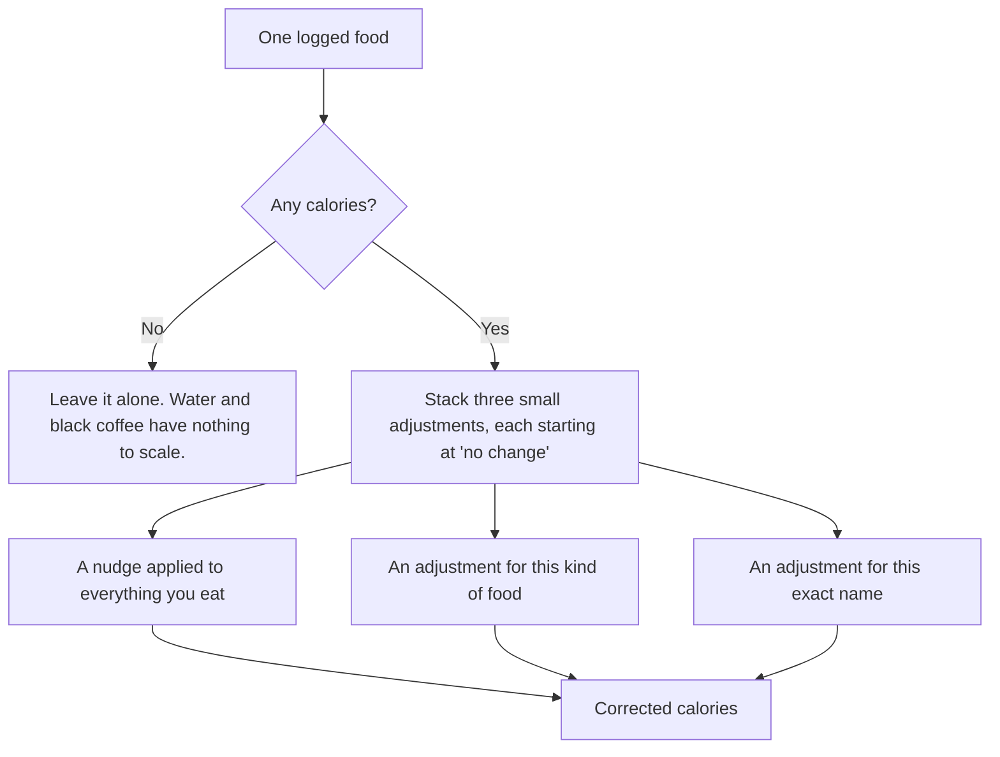
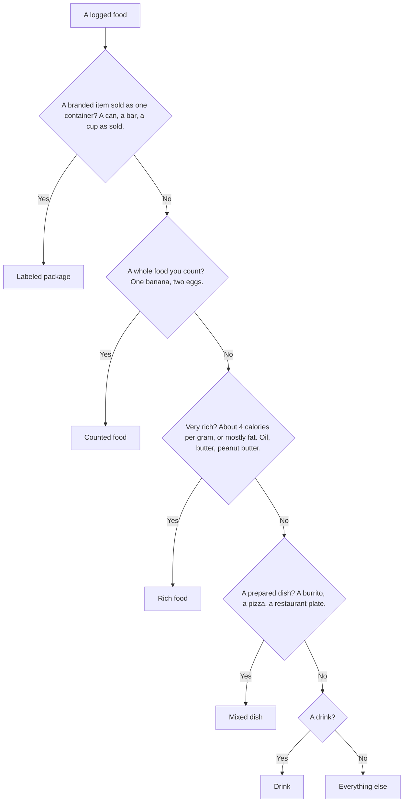
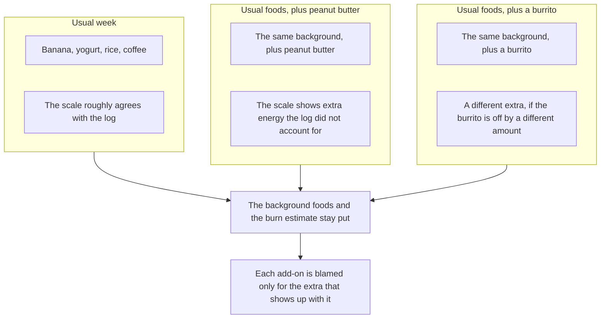
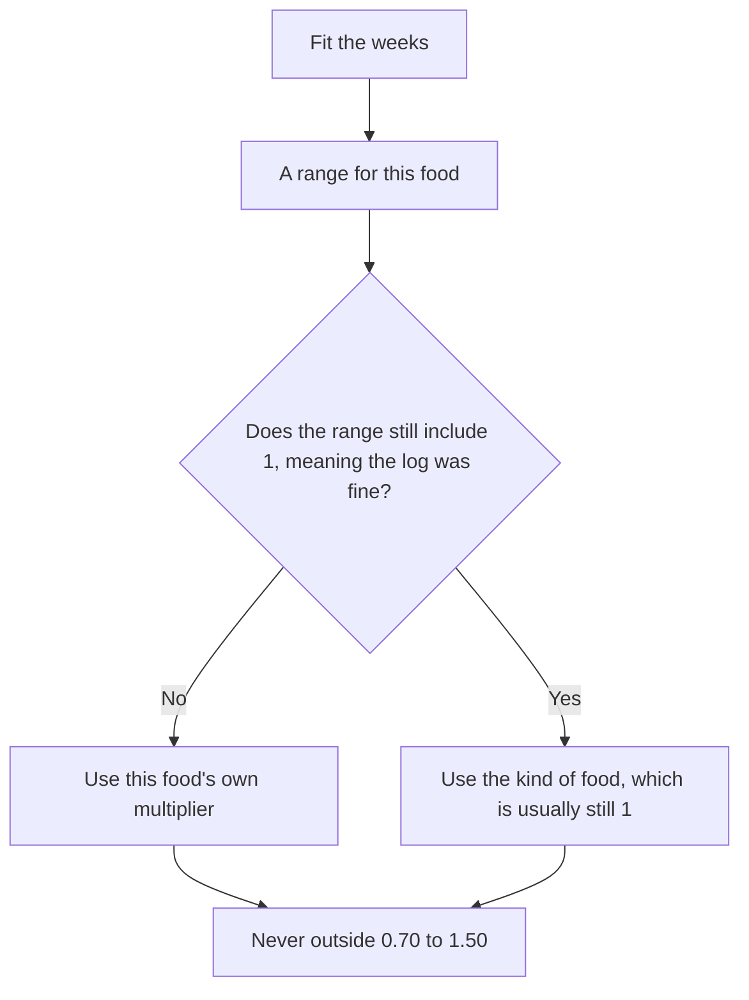
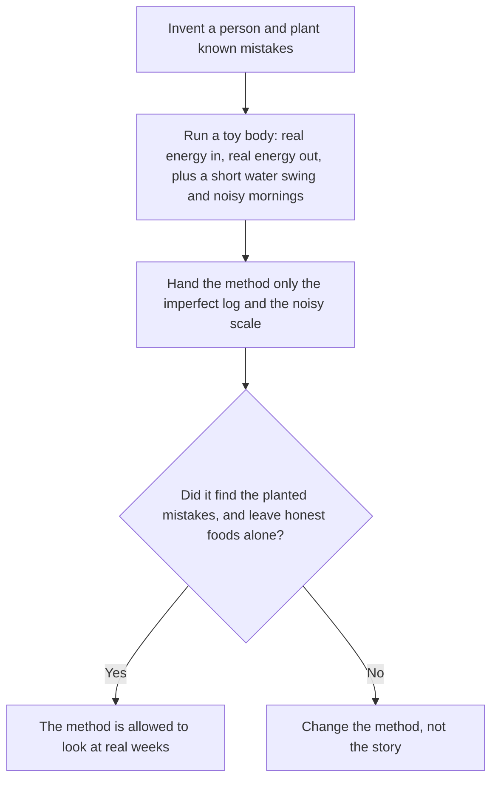
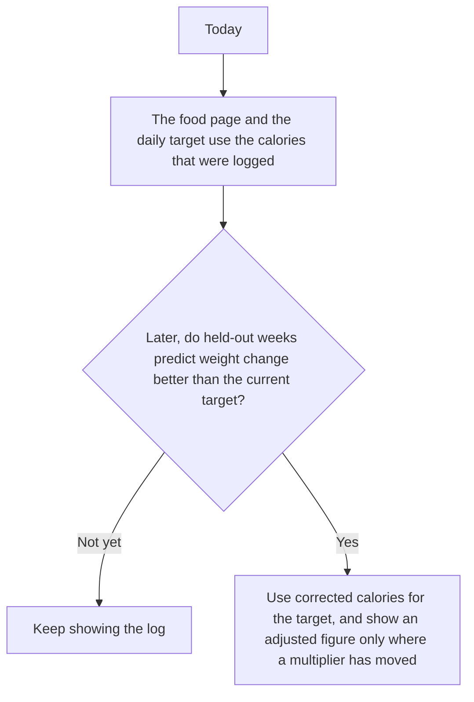

# Correcting the food log with the scale

The food log is a reasonable guess, not a measurement. Portions are approximate, a restaurant plate does not come with an ingredient list, and there is no accurate count of calories burned. The correction described here uses the scale to improve that guess over time. It does not rewrite old meals. It also does not change the daily calorie target until it has earned that trust.

## The scale only answers one question

If you eat more than you burn, you gain weight. If you burn more than you eat, you lose weight. A useful rule of thumb is that a pound of body weight is about 3,500 calories, so a week of weight change is a week of energy, added up.

That total does not say *where* the error was.

A week where you lost less than the log predicted can mean two things:

- The portions were bigger than what was written down.
- Your body burned less than the body-size formula guessed.

Both stories fit the same scale reading. The correction never pretends it can pick one of those stories from a single number.

## Why a week, not a meal or a day

One meal has no outcome of its own. One morning on the scale is mostly water, salt, and whatever is still in your gut. A stretch of about a week averages some of that noise out.

A blank day is set aside on purpose. If Tuesday was never written down, the week looks like the foods from the other days had fewer calories than they really did. Guessing what Tuesday contained would bake that mistake in. A single missed day is allowed. More than that, and the stretch is ignored.

Daily weigh-ins are grouped into these stretches, about a week at a time, so the same days are not counted twice. The preferred length is 7 days. Anything from 5 to 14 can be used. A one-day gap between morning weigh-ins is too noisy, and a three-week gap is too blurry.

Even a clean week is a fuzzy lesson. Half a pound of water is on the order of 1,750 calories, and the up-and-down of ordinary mornings still leaves a few hundred calories a day of uncertainty. The method treats every week as at least that uncertain, so one quiet week cannot boss the result around.

## What a lesson looks like

For each usable stretch the method lines up three numbers:

1. The calories in the log.
2. A burn estimate from body size, age, and the activity level in settings. This is the same Mifflin-St Jeor estimate the daily recommendation already uses.
3. The calories implied by the slope of the scale.

The gap is split. It is not handed entirely to the foods, and it is not handed entirely to the burn. Today the daily recommendation does the opposite: it treats the log as true and uses the whole gap to adjust the burn. These two adjustments must not both be turned on, or the same gap would be counted twice.

## The correction is a multiplier

Each food gets a multiplier near 1.

| Multiplier | Meaning |
| --- | --- |
| 1.0 | Trust the log for this food. |
| 1.25 | The real amount was about 25% larger than what was written down. |
| 0.80 | The log was about 20% high. |

The same multiplier scales calories, protein, fat, carbohydrate, and fiber. The usual mistake is the amount, or a hidden ingredient that shows up the same way every time you order that dish. The scale cannot see whether the missing calories were oil or rice. It can only see the total.

Applied multipliers are kept between 0.70 and 1.50. A wild week cannot turn a banana into a triple portion or into almost nothing.

Protein takes a little more energy to digest than fat or carbohydrate. That is a fixed, small adjustment so a high-protein week is not mistaken for a smaller portion. It is not learned from the scale.

## Same habit, same factor

The method assumes you are roughly consistent. When you write "chicken burrito," you tend to mean a similar plate, with a similar amount of whatever the log cannot see. The name is the habit: "banana" inside a larger meal is the same banana as a meal that is only a banana. The USDA catalog number is not the habit.

The three layers exist because a single multiplier on the whole day is the thing the scale cannot identify. A multiplier on one kind of food can be identified, but only when that kind is a big part of some weeks and absent from others.

A specific name gets its own adjustment only when all of these are true:

- It appears in at least four separate usable stretches.
- Its share of the week's calories actually changes from stretch to stretch.
- It is not simply the whole of its kind. If peanut butter is the only rich food you eat, the "rich food" adjustment already covers it. A second number would be made up.

Until a name earns its own adjustment, it uses the adjustment for its kind. And a name's own number is used for future meals only when the plausible range no longer includes 1. If the range still includes "the log was fine," the kind is what gets applied, and the meal can look unchanged.

Every layer starts at "the log is right." Weeks can pull a layer away from that. They have a hard time pulling the everything-nudge, an easier time pulling a kind, and they need a repeated, varying food before a name moves at all.

## Kinds of food

The kind is chosen from the log entry with a fixed list, before any personal history exists. The first match wins.

These are buckets, not accusations. A mixed dish is not assumed to be under-logged. It starts at a multiplier of 1, like everything else. The bucket only means "these foods may share a mistake, so they can teach each other before any one of them has been repeated for months."

Counted foods and sealed packages are the ones most likely to stay near 1. Spoons of peanut butter and restaurant plates are the ones with room to move, if the weeks support it.

## How a food gets the blame

Imagine three kinds of week, with the same background meals:

The peanut butter's multiplier is the extra energy that shows up in peanut-butter weeks and disappears when the peanut butter does. The banana is in every week, so it cannot be separated from your overall burn. Leaving the banana at 1 is the correct answer, not a failure to learn.

If every week is the same menu, nothing can be separated. A 15% miss can be "you burn more than the formula" or "every food is under-logged." The method then prefers the burn adjustment, and the food multipliers stay near 1. That preference is deliberate. A food multiplier should not move just because the activity setting in the app is a bit off.

## What "pretty sure" means

Each multiplier comes with a range, not just a point. The range is the values that still fit the weeks once ordinary scale noise is allowed for.

A category that is a large part of some weeks and missing from others can move sooner. A food that is a steady side dish may never get its own number. In a simulation, a 700-calorie add-on eaten one week out of three took on the order of 36 weeks before its range no longer included 1. Expect months, not days, and only for foods whose presence actually changes.

## Practice before your own history

Your log will not have enough weeks at the start, and copying correction factors from national diet surveys would be the wrong shortcut. Those surveys miss foods for different reasons than this app does. A survey respondent forgets a snack. This app writes the snack down and then guesses a typical serving.

The pretend person is checked against four situations:

| Situation | What has to happen |
| --- | --- |
| Twelve weeks that alternate an ordinary menu, a peanut-butter menu, and a burrito menu | The rich food and the mixed dish land near the mistakes that were planted. Counted foods stay within about 5% of the log. |
| Every food logged honestly, but the true burn 15% above the formula | The food multipliers barely move. The difference shows up as a higher burn. |
| About two days in every five never written down | Those stretches are ignored, and every multiplier stays at 1. If the filter is removed, the method invents a correction. That is the bug the filter exists to prevent. |
| The same story repeated with noisy mornings | The reported ranges cover the planted mistakes most of the time, and the ranges are not shrunk to a false pinpoint. |

Public research is used only to decide how wide a mistake is allowed to be before the weeks have spoken. Self-reported diets are often low, sometimes by a lot, and the miss is not the same for every food. That is a reason to let a multiplier sit somewhere between about 0.7 and 1.4 if the evidence is strong. It is not a reason to start you at "eat 15% less" before a single week of your own data. The starting guess is that your log is right.

Studies that measure burn with doubly labeled water are about burn, not about your burrito. National diet recalls are about other people's memory. Neither is mixed into your weeks.

## What the app does with this today

The comparison is a leave-one-week-out check. Hide one usable stretch, learn from the others, and see whether the hidden week's weight change was predicted better than by trusting the log and the current burn estimate. A fancier model has to beat a single overall multiplier, and that single multiplier has to beat leaving the log alone. If it does not, nothing changes.

The daily target's other rules stay either way: the goal is still maintenance, or 1,000 calories below maintenance when body mass index is 25 or higher, and the result is never under the safe floor. On a loss day the food page shows that pace as a range. The middle is the 2 lb a week intake. The bottom is the faster of that pace and about 1% of body weight a week, and it never goes under the safe floor. Expenditure blends from body size toward the last few weeks of food and weight as that stretch gets longer. The previous 7 days nudge both ends by about a seventh of their gap from that pace, so one high or low day does not rewrite the next day. A day under 800 kcal does not move the range.

## Limits worth remembering

- Alcohol, a forgotten snack, or a real change in activity that was never updated in settings all look like a food error. A constant miss tends to land on the burn adjustment. A miss that shows up only next to one food sticks to that food.
- A new restaurant order has only its kind's multiplier until that same name has been repeated across four separated stretches and the range excludes "no change."
- Scaling every macro by one number is wrong when the miss is oil on an otherwise accurate piece of chicken. The calorie total can still be reasonable. The protein and carbohydrate totals will be a bit high for that meal.
- The 3,500-calorie pound is an average for fat, not for this week's water. Wide uncertainty on each stretch is what keeps a salty weekend from rewriting the log.
